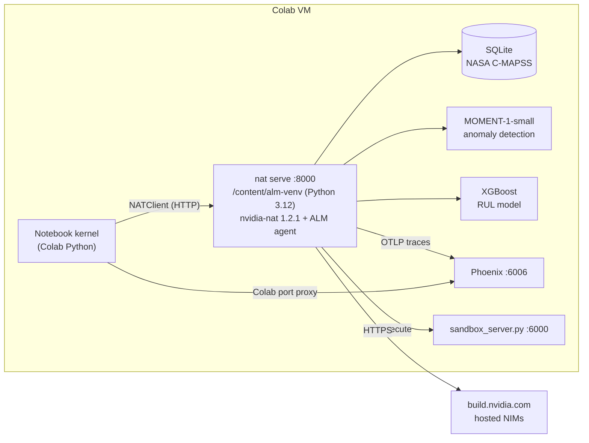

# NATcolab

**NVIDIA NeMo Agent Toolkit (NAT) — *Building Observable and Scalable Multi-Agent Workflows for Asset Lifecycle Management* — adapted to run end-to-end in Google Colab with hosted NVIDIA NIMs.**

The original course runs in an NVIDIA DLI lab image (`/dli/task`, a pre-built `/opt/predm-lab` venv, local NIM / NV-Tesseract / sandbox Docker containers, JupyterLab terminals). This repo recreates that environment inside a Colab VM with one setup cell, swaps the self-hosted models for hosted NIMs on [build.nvidia.com](https://build.nvidia.com), and keeps the course content and exercises intact.

| # | Notebook | Open |
|---|---|---|
| 0 | Setup & Introduction (database, RUL model, NIM check) | [](https://colab.research.google.com/github/bsudharsh1979/NATcolab/blob/main/notebooks/0_ALM_Database_Setup.ipynb) |
| 1 | Basic Interaction — `nat serve`, client, queries, intermediate steps | [](https://colab.research.google.com/github/bsudharsh1979/NATcolab/blob/main/notebooks/1_ALM_Application_Setup.ipynb) |
| 2 | Configuration & Tool Customization (temperature, plot color, new tool) | [](https://colab.research.google.com/github/bsudharsh1979/NATcolab/blob/main/notebooks/2_ALM_Config_Understanding.ipynb) |
| 3 | Observability with Phoenix | [](https://colab.research.google.com/github/bsudharsh1979/NATcolab/blob/main/notebooks/3_ALM_Observability.ipynb) |
| 4 | Evaluation with `nat eval` + multimodal LLM judge | [](https://colab.research.google.com/github/bsudharsh1979/NATcolab/blob/main/notebooks/4_ALM_Evaluation.ipynb) |
| 5 | Time-series foundation models & anomaly detection | [](https://colab.research.google.com/github/bsudharsh1979/NATcolab/blob/main/notebooks/5_ALM_AnomalyDetection.ipynb) |
| O | Optional — Code generation & sandboxed execution | [](https://colab.research.google.com/github/bsudharsh1979/NATcolab/blob/main/notebooks/Optional_ALM_Codegen.ipynb) |
| A | Assessment — build `plot_line_chart_with_ma_tool`, trace it, analyze it | [](https://colab.research.google.com/github/bsudharsh1979/NATcolab/blob/main/notebooks/ALM_assessment.ipynb) |

## Quick start

1. Get an NVIDIA API key at [build.nvidia.com](https://build.nvidia.com) (starts with `nvapi-`).
2. Open any notebook above in Colab → 🔑 **Secrets** (left sidebar) → *Add new secret* named **`NVIDIA_API_KEY`** → paste the key → enable **Notebook access**.
3. **Runtime → Run all.** A CPU runtime is enough.

The first cell clones this repo to `/content/NATcolab` and calls `colab_bootstrap.bootstrap()` (≈5–8 min on a fresh runtime, a few seconds afterwards). Colab gives every notebook its own VM, so each notebook starts with that cell and is fully self-contained — you can open them in any order.

> [!IMPORTANT]
> Never paste your API key into a notebook cell or commit it to git. The setup cell reads it from Colab Secrets (or the `NVIDIA_API_KEY` environment variable, or prompts for it with a hidden input).

## NVIDIA NIMs used

| Role (`configs/config-reasoning.yml`) | Model | Why |
|---|---|---|
| `reasoning_llm` — planner (reasoning agent) | `nvidia/nemotron-3-ultra-550b-a55b` | strongest reasoning; produces the step-by-step plan |
| `analyst_llm` — ReAct executor / tool calling | `nvidia/nemotron-3-ultra-550b-a55b` | follows the strict ReAct format reliably |
| `sql_llm` — Vanna text-to-SQL | `nvidia/nemotron-3-ultra-550b-a55b` | accurate SQL with a short reasoning trace |
| `coding_llm` — code generation (Optional notebook) | `nvidia/nemotron-3.5-lightning-30b-a3b` | fast coder with long outputs (`max_tokens: 16384`) |
| `multimodal_judging_llm` — `nat eval` judge | `nvidia/nemotron-3-nano-omni-30b-a3b-reasoning` | vision + text: scores generated plots and answers |
| `vanna_embedder` — embeddings | `nvidia/nemotron-3.5-embed-1b` | current hosted embedding NIM (the upstream defaults have reached end-of-life) |
| anomaly detection | MOMENT-1-small (local, open source) | NV-Tesseract is a self-hosted NIM only |

`colab_bootstrap.check_nims()` pings every endpoint during setup. To try other models, edit `configs/config-reasoning.yml` (and `NIM_MODELS` in `colab_bootstrap.py` for the health check).

## How it works



`colab_bootstrap.bootstrap()` (idempotent):

1. loads `NVIDIA_API_KEY` (Colab Secrets → env → hidden prompt);
2. fetches the agent source from [NVIDIA/GenerativeAIExamples `industries/asset_lifecycle_management_agent`](https://github.com/NVIDIA/GenerativeAIExamples/tree/main/industries/asset_lifecycle_management_agent) at a pinned commit and applies three small patches (install MOMENT separately, honour the configured embedding model, fix a hard-coded output path);
3. creates an isolated Python 3.12 venv with `uv` (independent of Colab's Python version) and installs `nvidia-nat[langchain,profiling,telemetry]==1.2.1`, the agent package, CPU PyTorch and MOMENT;
4. prepares `agent_workspace/` (+ `/workspace` symlink used by generated code), builds `database/nasa_turbo.db`, trains the XGBoost RUL model, caches the MOMENT weights;
5. snapshots pristine copies of the sources/config for `client.reset()`, and checks every NIM.

## What changed vs. the DLI lab

| DLI lab | NATcolab |
|---|---|
| `/dli/task`, `/opt/predm-lab` | `/content/NATcolab`, `/content/alm-venv` (override with `ALM_HOME` / `ALM_VENV`) |
| Local NIM container (`http://nim:8000`) | Hosted NIMs on `integrate.api.nvidia.com` |
| NV-Tesseract NIM for anomaly detection | MOMENT-1-small (`moment_anomaly_detection_tool`) |
| Pre-trained `models/*.pkl` in the image | `train_rul_model.py` trains them (validation RMSE ≈ 21 cycles) |
| Docker code sandbox (`code_execution_sandbox:6000`) | `sandbox_server.py` (same `/execute` API, subprocess per request) |
| Phoenix / NAT UI started in JupyterLab terminals | `client.start_phoenix()`, `link(6006)` through the Colab proxy; intermediate steps streamed with `client.query(..., show_steps=True)` |
| `cp /dli/task/Exercise_Solutions/...` | `exercise_solutions.py` (idempotent helpers; `client.reset()` undoes them) |
| DLI auto-grader | Assessment deliverables validated in-notebook and zipped for download |

### Python files

| File | Purpose |
|---|---|
| `colab_bootstrap.py` | one-call environment setup (see above) |
| `nat_client.py` | `NATClient` — start/stop/restart `nat serve` (waits until healthy), query (optionally streaming intermediate steps), logs, `show()` outputs, `reset()`, Phoenix + sandbox helpers, `link(port)` for Colab-proxied URLs |
| `setup_database.py` | NASA C-MAPSS → SQLite (multiple download mirrors, nested-zip aware) |
| `train_rul_model.py` | trains the StandardScaler + XGBoost model used by `predict_rul` |
| `sandbox_server.py` | Docker-free code-execution sandbox for `code_generation_assistant` |
| `exercise_solutions.py` | exercise solutions (temperature, plot color, action-recommendation tool, Phoenix tracing, code generation) |
| `phoenix_tools.py` | read/summarize/export Phoenix traces from the notebook kernel |
| `Assessment/plot_line_chart_with_ma_tool.py` | completed assessment tool (moving-average overlay) |
| `configs/config-reasoning.yml` | NAT workflow config (hosted NIMs, MOMENT, `agent_workspace`) |

## Running outside Colab

Any Linux/macOS machine with Python ≥ 3.10, `git` and internet access works:

```bash
git clone https://github.com/bsudharsh1979/NATcolab.git && cd NATcolab
export NVIDIA_API_KEY=nvapi-...          # your key
python -c "import colab_bootstrap; colab_bootstrap.bootstrap()"
jupyter lab notebooks/                    # or: python ci/smoke_test.py
```

Optional environment variables: `ALM_HOME` (repo path), `ALM_VENV` (venv path, default `/content/alm-venv` in Colab, `./.alm-venv` elsewhere), `ALM_TORCH=cuda` (CUDA PyTorch instead of CPU), `ALM_PYTHON` (venv Python, default `3.12`), `ALM_UV_ARGS` (extra `uv pip install` args), `ALM_UPSTREAM_SHA` (agent source commit).

## Troubleshooting

- **`429 Too Many Requests`** — the hosted endpoints are rate limited; an agent query makes ~5–10 LLM calls. Wait a minute and re-run, or raise the eval `query_delay`.
- **`410 Gone` / `404 Not Found` for a model** — the model was retired or is not enabled for your account; pick another model from [build.nvidia.com](https://build.nvidia.com/models) and update `configs/config-reasoning.yml`.
- **Backend does not start** — `client.logs(60)` shows the `nat serve` log; the first start trains the Vanna retriever (≈1–2 min).
- **Start over** — `client.reset()` restores the original sources/config; *Runtime → Disconnect and delete runtime* resets everything.

## Continuous verification

`ci/smoke_test.py` (bootstrap + three agent queries) and `ci/run_notebooks.py` (executes every notebook headlessly) run the same code a Colab runtime runs. `ci/colab-check.workflow.yml` is a ready-to-use GitHub Actions workflow (Ubuntu + Python 3.12): copy it to `.github/workflows/` and add the repository secret `NVIDIA_API_KEY` to run it from the *Actions* tab.

## Credits & licenses

- Agent source: [NVIDIA/GenerativeAIExamples](https://github.com/NVIDIA/GenerativeAIExamples) (Apache-2.0), fetched at runtime and not redistributed here.
- [NVIDIA NeMo Agent Toolkit](https://github.com/NVIDIA/NeMo-Agent-Toolkit), [MOMENT](https://github.com/moment-timeseries-foundation-model/moment), [Arize Phoenix](https://github.com/Arize-ai/phoenix), [Vanna](https://github.com/vanna-ai/vanna).
- Course narrative adapted from the NVIDIA Deep Learning Institute *Asset Lifecycle Management with Agentic AI* lab. NASA C-MAPSS data courtesy of the NASA Prognostics Center of Excellence.
